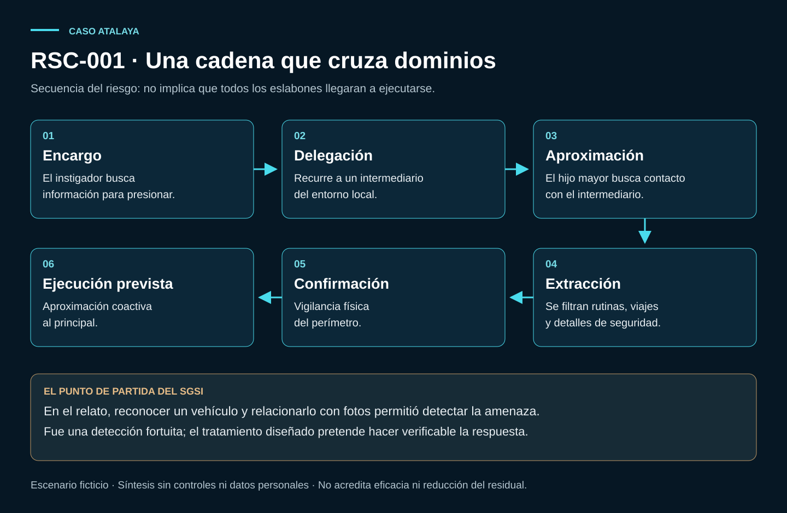
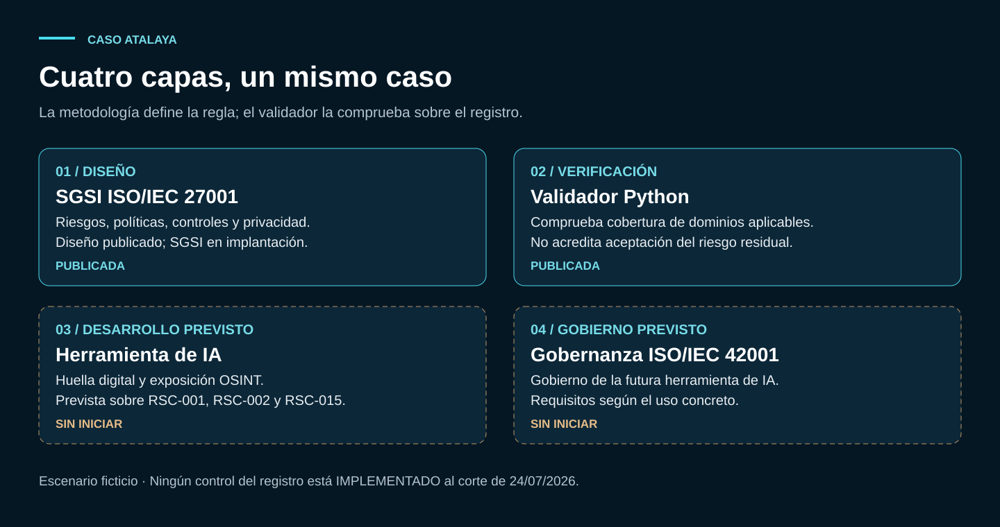

# Caso Atalaya — Seguridad convergente para un family office


[](https://github.com/tarquistwr-hash/caso-atalaya/actions/workflows/pruebas.yml)

**Un caso práctico de seguridad convergente sobre un escenario ficticio de gran patrimonio. Publicados: diseño del SGSI ISO/IEC 27001 y validador Python. Planificados y sin iniciar: herramienta de IA y su gobernanza ISO/IEC 42001. El sistema sigue en implantación.**

**EN — Abstract.** A convergent-security case study built on a fictional family office scenario: a full ISO/IEC 27001 ISMS (scenario-based risk methodology, 25-scenario risk register, 93-control SoA, and an applicability-based coverage rule checked against declared evidence, dates and control scope), a Python validator that executes that rule against the register, an AI agent for family digital-footprint monitoring (planned, not started), and ISO/IEC 42001 governance of that agent. Fictional in its data, real in its substance: every design decision is justified in context. Documentation in Spanish.

> ⚠️ **Escenario íntegramente ficticio.** Personas, sociedades, patrimonios y hechos son inventados y no guardan relación con ninguna persona u organización real. La verosimilitud procede de experiencia profesional real en protección ejecutiva y patrimonial; los datos, no.

## En cinco minutos

- **Qué demuestra:** cómo analizar los dominios físico y digital de cada riesgo, justificar su aplicabilidad y comprobar la cobertura de los dominios exigibles. El resultado no equivale a aceptar el riesgo residual.
- **Qué leer primero:** el [informe ejecutivo para la propiedad](deliverables/fase1/vigente/SGSIINF001_Informe_Ejecutivo_Propiedad_v2_0.pdf) (visión de dirección) y [la regla de convergencia como árbol de decisión](docs/fase1-iso27001/regla_convergencia.md).
- **Verlo funcionar:** [vídeo de la herramienta](https://youtu.be/0B5Mc03_dyg) (versión anterior: la regla y los resultados han cambiado; consultar la demostración actual) y [`tool/convergence-check`](tool/convergence-check/README.md).
- **Estado:** capas 1 y 2 publicadas; capas 3 y 4 no iniciadas. Fase 1 cerrada en la [línea base 2.0 de 13/11/2026](docs/fase1-iso27001/linea_base_2026-11-13.md): diecinueve documentos vigentes y uno pendiente de firma. El SGSI está en implantación, con cuatro no conformidades abiertas, y no simula evidencias de ejecución.

---

## Por qué este caso

Los grandes patrimonios se protegen por silos: una empresa lleva la seguridad física, un MSP lleva "la informática", y nadie es dueño del espacio entre ambos. Los ataques reales no respetan esa división: empiezan en Instagram y terminan en la puerta de la finca. Este caso demuestra, pieza a pieza y con documentos reales de sistema de gestión, cómo se diseña seguridad para el conjunto.

El incidente que articula el escenario: un antiguo promotor deportivo con una cuenta pendiente encarga a un intermediario local reunir información sobre la familia. El intermediario se deja ver donde se mueve el hijo adolescente, y es el chaval quien busca el contacto. Durante semanas le suelta rutinas, viajes y detalles de la seguridad de la finca. Se destapa porque alguien del servicio de seguridad **reconoce un coche** aparcado donde no debe y lo vuelve a ver, semanas después, en las fotos que el chico publica.

Eso último es lo importante: la detección funcionó **por azar**. Dependía de que esa persona estuviera de servicio, se acordara del vehículo y atara los dos cabos. Ningún control puramente físico ni puramente digital habría cortado la cadena, y el que la cortó no era repetible ni auditable. Ese es el problema que el caso resuelve.



[Ver la cadena completa y el tratamiento diseñado](docs/fase1-iso27001/cadena_rsc001.md).

## El escenario en una línea

Family office español (9 personas, Marbella) de un exboxeador irlandés con ~110 M€, familia con tres hijos —uno de ellos influencer adolescente—, patrimonio en dos jurisdicciones, un círculo de confianza histórico sin marco formal y un MSP que administra desde el correo hasta las cámaras. Ficha completa: [`docs/escenario/00_escenario_caso_convergente.md`](docs/escenario/00_escenario_caso_convergente.md)

## Las cuatro capas



<details>
<summary>Ver contenido y alcance de cada capa</summary>

| Capa | Contenido | Estado |
|---|---|---|
| **1 — SGSI ISO/IEC 27001** | Sistema completo del family office: contexto, política, metodología de riesgos por escenarios, registro de 25 escenarios con 64 controles trazados uno a uno, plan de tratamiento con el residual aceptado por el propietario de cada riesgo, SoA de 93 controles justificados, las políticas que tratan los riesgos dominantes, y el bloque RGPD (RAT, ponderación del interés legítimo, EIPD) sobre los tratamientos de datos personales que el sistema genera | ✅ Publicada |
| **2 — `convergence-check`** | Validador en Python que ejecuta la regla de convergencia sobre el registro: filtra los escenarios Alto y Crítico y comprueba si cada uno alcanza cobertura efectiva en sus dominios aplicables. Es la verificación técnica que la propia metodología exige | ✅ Publicada |
| **3 — Herramienta de IA** | Monitorización de huella digital y exposición OSINT de la familia con alerta temprana, sobre el mismo escenario (trata los riesgos RSC-001, RSC-002 y RSC-015 del registro) | ⏳ No iniciada |
| **4 — Gobernanza ISO/IEC 42001** | Gobierno de la futura herramienta de IA. Su clasificación jurídica y los requisitos aplicables se determinarán sobre el uso concreto; no se presume una clasificación legal por tratar datos de menores | ⏳ No iniciada |

</details>

Las capas 1 y 2 se construyen juntas y son inseparables por diseño: la regla de convergencia se escribe como norma en la metodología y se ejecuta como código sobre el registro. Las capas 3 y 4 llegan con el capstone del bootcamp de AI Engineering y después.

## Estructura del repositorio

```
.
├── README.md                             ← esto
├── LICENSE                               ← MIT para el código; la documentación, CC BY-NC 4.0
├── assets/readme/                        ← portada y diagramas del README, con fuentes e historial
├── docs/
│   ├── escenario/
│   │   └── 00_escenario_caso_convergente.md
│   └── fase1-iso27001/
│       ├── index.md                      ← índice comentado de la documentación
│       ├── decisiones.md                 ← las decisiones de diseño y su porqué
│       ├── linea_base_2026-11-13.md      ← qué se aprobó al cerrar la Fase 1 y qué cambió
│       ├── cadena_rsc001.md              ← el riesgo estrella, dibujado
│       ├── mapa_interfaces.md            ← las diez interfaces del alcance, dibujadas
│       ├── regla_convergencia.md         ← la regla de convergencia como árbol de decisión
│       ├── flujo_verificacion_ordenes.md ← el circuito antifraude de DOC-007
│       └── historial/                    ← notas de las revisiones anteriores a la línea base
├── deliverables/fase1/
│   ├── README.md                         ← tabla de los veinte documentos vigentes
│   ├── vigente/                          ← línea base 2.0: Word/Excel editables y su PDF
│   └── historico/                        ← entregas anteriores, obsoletas
└── tool/convergence-check/               ← capa 2: el validador
    ├── project.py
    ├── test_project.py
    ├── check_corpus.py                   ← coherencia entre los Excel, los CSV y la SoA
    ├── README.md                         ← uso, esquema de los CSV y limitaciones conocidas
    ├── requirements.txt
    ├── riesgos.csv                       ← registro real a fecha de corte
    ├── controles.csv                     ← controles reales a fecha de corte
    └── controles_junio.csv               ← estado simulado a fecha futura, con defectos deliberados
```

## La regla, y la máquina que la comprueba

La tesis del caso cabe en una frase: **se analizan siempre los dominios físico y digital; se exige cobertura en los que intervienen en cada escenario Alto o Crítico.** La no aplicabilidad se justifica y lo pendiente no se da por cubierto. Los controles organizativos se conservan, sin equipararlos automáticamente a cobertura física o digital.

Eso no es un párrafo de introducción: es un requisito de la metodología (SGSI-DOC-004 §6) con una definición operativa de cobertura efectiva —control implantado, con evidencia registrada, verificación dentro de plazo y alcance GENERAL justificado— y con un programa que la ejecuta sobre el registro completo.

```
$ python project.py riesgos.csv controles_junio.csv 30/06/2027

RSC-001 Cumple cobertura de los dominios aplicables
RSC-002 Cumple cobertura de los dominios aplicables
RSC-003 Cumple cobertura de los dominios aplicables
RSC-004 Falta cobertura física
RSC-005 Cumple cobertura de los dominios aplicables
RSC-006 Falta cobertura digital
RSC-007 Cumple cobertura de los dominios aplicables
RSC-008 Cumple cobertura de los dominios aplicables
RSC-009 Cumple cobertura de los dominios aplicables
RSC-010 Falta cobertura digital
RSC-011 Cumple cobertura de los dominios aplicables
RSC-012 Cumple cobertura de los dominios aplicables
RSC-013 Cumple cobertura de los dominios aplicables
RSC-014 Evaluación pendiente de dominios
RSC-015 Cumple cobertura de los dominios aplicables
RSC-016 Falta cobertura digital
RSC-018 Sin cobertura en los dominios aplicables
RSC-019 Cumple cobertura de los dominios aplicables
RSC-020 Falta cobertura digital
RSC-021 Cumple cobertura de los dominios aplicables
RSC-022 Falta cobertura física
RSC-023 Cumple cobertura de los dominios aplicables
RSC-024 Cumple cobertura de los dominios aplicables
RSC-025 Cumple cobertura de los dominios aplicables
```

En la demostración a 30/06/2027: **16 escenarios cumplen la cobertura de sus dominios aplicables, 7 presentan carencias y 1 tiene evaluación de dominios pendiente (RSC-014)**. No se acredita aceptación del residual. RSC-018 conserva verificaciones vencidas; RSC-016 tiene C-020 organizativo, pero ninguna medida digital computable. [Salida completa](tool/convergence-check/ejemplo_demo.txt).

Ese resultado no es casual: `controles_junio.csv` no es una proyección optimista del plan de tratamiento, sino un estado simulado a fecha futura construido con defectos deliberados —verificaciones caducadas y dos controles que siguen sin implantar— para comprobar los diagnósticos de cobertura, sus carencias y las evaluaciones pendientes. El estado real del sistema a fecha de corte es `controles.csv`, y ahí ningún escenario evaluable acredita cobertura; RSC-014 conserva además la evaluación pendiente.

Detalle de uso, esquema de los CSV y suite de pruebas: [`tool/convergence-check/README.md`](tool/convergence-check/README.md)

## Documentación de la capa 1

| Código | Documento | Qué decide |
|---|---|---|
| SGSI-DOC-001 | Contexto y Alcance | La residencia entra en alcance; las sociedades irlandesas salen como organizaciones pero su flujo de información queda como interfaz; la familia no es "usuario interno" y se gestiona por acuerdo |
| SGSI-DOC-002 | Control documental | 4 niveles de clasificación; "rutinas de la familia = Restringida, siempre"; plazos de retención de todos los registros, incluidos los que contienen datos personales |
| SGSI-DOC-003 | Política de Seguridad | Política en dos niveles: declaración de una página en lenguaje llano firmada por el principal + desarrollo aprobado por delegación. Comité de Seguridad Convergente con el jefe de seguridad física dentro. Distingue el Responsable del SGSI (ISO 27001) del Responsable del Tratamiento (RGPD): son el mismo órgano de gobierno, con responsabilidades distintas |
| SGSI-DOC-004 | Metodología de riesgos | Basada en escenarios (ISO 27005, enfoque por eventos), no por activos: los riesgos que importan aquí son cadenas que cruzan dominios. Regla del máximo en impacto. Probabilidad por acumulación de condiciones de exposición, con el nivel máximo condicionado a señal observada. Alto/crítico exigen cobertura efectiva en los dominios justificados: implantada, con evidencia, verificada en plazo y con alcance suficiente |
| SGSI-DOC-005 | Objetivos 2026-27 | 12 objetivos medibles. Los 7 primeros miden implantación; los 5 últimos, ejecución sostenida. Dos indicadores miden fricción y no llevan meta de reducción |
| SGSI-DOC-006 | Terceros y círculo de confianza | El nivel de exigencia lo fija el acceso real, no el vínculo. Regularización del círculo histórico sin romperlo. Y una sección donde la política declara su propio límite: los invitados de la familia no son terceros contractuales, y por ahí entró el incidente |
| SGSI-DOC-007 | Verificación de órdenes financieras | Doble canal siempre; la voz no verifica (voz sintética); cuatro ojos; el freno de emergencia no penaliza. Y cinco reglas para el dinero que se mueve en efectivo, que no viajaba por ningún canal verificable |
| SGSI-DOC-008 | Seguridad en viajes | Necesidad de conocer por tramos; publicación diferida en lugar de prohibición (la prohibición a un adolescente garantiza el incumplimiento); evaluación del destino antes de la reserva, no después |
| SGSI-DOC-009 | Incidentes convergentes | Canal único, cuaderno común de indicios físicos y digitales, revisión semanal de correlación con umbral deliberadamente bajo |
| SGSI-DOC-010 | Auditoría, revisión por la dirección y mejora | Diseñados sin simular ejecuciones: programa de auditoría externalizada (con 9 personas no hay independencia interna posible), revisión anual con la propiedad, y no conformidades con verificación de eficacia |
| SGSI-DOC-011 | Necesidad, proporcionalidad y ponderación | Distingue el marco de videovigilancia de las finalidades basadas en interés legítimo. No sustituye una habilitación legal para datos penales ni una evaluación residual. |
| SGSI-DOC-012 | Evaluación de impacto en protección de datos | Identifica tres riesgos Altos para los interesados y conserva su nivel mientras no se justifique reducirlo. La decisión sobre la consulta previa a la autoridad está abierta, con responsable y plazo (HD-10). |

| Código | Registro | Contenido |
|---|---|---|
| SGSI-REG-001/002 | Registro de riesgos + plan de tratamiento (un libro, cinco hojas) | 25 escenarios narrados como cadenas, valorados y tratados eslabón a eslabón, cada uno situado en las interfaces del alcance con vocabulario cerrado. 64 controles, uno por fila, cada uno con dominio, estado, evidencia y periodicidad de verificación: así la regla de convergencia se puede ejecutar por máquina. 16 planes con su residual aceptado por el propietario del riesgo y, cuando es Alto, ratificado por el Comité; plazos contados desde la replanificación de 13/11/2026 |
| SGSI-REG-003 | Declaración de Aplicabilidad | 93 controles: 83 aplicables y 10 excluidos, cada uno justificado. 50 se apoyan en un control del registro, 20 en un documento y 13 constan como deuda documental (NC-2026-002). Las exclusiones se revisan una a una si cambia el alcance |
| SGSI-REG-004 | Cuaderno único de indicios | Estructura de registro y revisión de correlaciones, con descarte razonado. La reconstrucción es condicional y no garantiza detección en semana 4; la evaluación y la severidad S2 se distinguen. |
| SGSI-REG-005 | Registro de requisitos legales | RGPD/LOPDGDD, videovigilancia, seguridad privada, fiscal ES/IE, límites al pago en efectivo, coordinación de actividades empresariales, contractuales; NIS2 y DORA evaluados y descartados por escrito |
| SGSI-REG-006 | No conformidades y deuda de diseño | Once hallazgos de diseño: cuatro cerrados, tres abiertos en plazo y cuatro convertidos en no conformidad. Las cuatro no conformidades están abiertas: el proveedor informático sin contrato de encargo (NC-2026-001), trece controles sin soporte (NC-2026-002), dos escenarios sin cobertura de diseño (NC-2026-003) y, como mayor, los controles físicos sin evidencia y el retraso de los planes críticos (NC-2026-004) |
| SGSI-REG-008 | Registro de Actividades de Tratamiento (RAT, RGPD art. 30) | Diez tratamientos de datos personales (T-01 a T-10) que el SGSI genera —CCTV, contratas, visitas, cuaderno de indicios, gestión de personal doméstico, verificación de órdenes financieras y banca privada, viajes y agenda, documentación patrimonial/societaria/fiscal ES-IE, presencia pública del principal, y la administración de sistemas por el MSP (correo, NAS, CCTV, domótica)—, cada uno con responsable, encargado, finalidad, base jurídica, colectivo, categorías de datos, plazo de conservación y medidas de seguridad del SGSI que lo protegen. Es la fuente única que SGSI-DOC-011 y SGSI-DOC-012 dan por conocida y no repiten |
| SGSI-INF-001 | Informe ejecutivo para la propiedad | El sistema entero en lenguaje llano, a noviembre de 2026: qué se ha diseñado, qué no está hecho todavía, qué plazo venció sin cumplirse y qué se le pide a la propiedad |
| SGSI-ACU-004 | Anexo de encargo del tratamiento con el MSP (RGPD art. 28) | Texto aprobado por la Dirección General y pendiente de firma: sigue en Borrador porque un contrato sin firmar no está en vigor |

## Decisiones de diseño (lo que distingue esto de una plantilla)

1. **El alcance persigue a la información, no al organigrama.** La residencia está dentro; la conducta de la familia se gestiona por acuerdo, no por imposición.
2. **El riesgo se piensa como cadena.** El dominio de un escenario lo decide su cadena, y el de un control, cómo actúa y no en qué soporte vive. La primera versión de la regla exigía físico y digital a todo; produjo controles de relleno y se corrigió.
3. **La regla se ejecuta, no se declara.** Si un requisito solo se comprueba a mano, deja de comprobarse en cuanto el registro crece. Por eso la regla de convergencia tiene un validador propio, y por eso el registro está diseñado con una fila por control en lugar de una lista dentro de una celda.
4. **Un control que no se ejecuta no es un control.** La cobertura solo cuenta si está implantada, deja evidencia registrada y su verificación sigue en plazo. Por eso el propio sistema declara que a fecha de corte, sin ningún control del registro implantado, ningún escenario alcanza aún cobertura efectiva.
5. **El riesgo de todos los días entra en el catálogo.** El primer catálogo estaba construido desde el adversario y daba por buenos la alarma, el vigilante y el conductor porque están contratados. La revisión de campo dio entrada a ocho escenarios de fallo de ejecución y operativa material (RSC-018 a RSC-025), y con ellos el vuelco del caso: de los tres escenarios que alcanzan el nivel máximo del registro, dos no tienen adversario en el origen. Uno de ellos es, sencillamente, que la alarma no se conecta al cerrar.
6. **La probabilidad es exposición acumulada, no frecuencia.** Que caiga un rayo dentro de casa es imposible; en el campo, con tormenta, en un alto y con paraguas, probable. El rayo es el mismo: cambia dónde estás tú. El nivel máximo exige, además, una señal observada.
7. **El sistema asume a las personas reales que tiene.** Un principal que no lee documentos técnicos firma una declaración de una página que sí entiende. Un círculo de confianza de décadas se regulariza con acuerdos en lenguaje llano y la autoridad del propio principal, no con un NDA de despacho.
8. **La segregación de funciones imposible se confiesa y se compensa**, no se finge.
9. **El SGSI y el RGPD comparten sistema, no vocabulario.** Los tratamientos de datos personales que el SGSI genera —CCTV, cuaderno de indicios, correo del gestor de Irlanda— tienen su propio registro (RAT), su propia base jurídica y, cuando la vigilancia se intensifica sobre personas, su propio juicio de ponderación y su propia evaluación de impacto. No se resuelven por analogía con el registro de riesgos patrimoniales: la escala de esa evaluación mide el riesgo para el interesado, no para el patrimonio, y usa una matriz distinta a propósito.

10. **Un plazo que nadie mira vence sin que conste.** Entre julio y noviembre el diseño se revisó cuatro veces y no se implantó nada. La línea base lo registra como no conformidad mayor en lugar de mover las fechas en silencio, y añade lo que faltaba: alguien que mire el calendario cada mes.

El porqué de cada una, desarrollado: [`docs/fase1-iso27001/decisiones.md`](docs/fase1-iso27001/decisiones.md)

## Estado del sistema

- **Línea base 2.0, aprobada el 13/11/2026.** Diecinueve documentos vigentes; el anexo del proveedor informático, en Borrador hasta su firma. Qué se aprobó y qué cambió: [línea base de cierre de la Fase 1](docs/fase1-iso27001/linea_base_2026-11-13.md).
- **En implantación.** Los datos de estado de los controles son los del corte de 24/07/2026, confirmados sin variación el 13/11/2026: ningún control del registro está implantado, y por tanto ningún escenario alcanza todavía cobertura efectiva. El sistema lo dice en lugar de disimularlo.
- **Plazos.** Los de los planes de tratamiento y los objetivos se cuentan desde la replanificación de 13/11/2026. Los de la deuda de diseño y las no conformidades son fechas ciertas y están en SGSI-REG-006.
- **Qué es ficción y qué no se simula.** Las sesiones del Comité y sus aprobaciones son decisiones narrativas del escenario, igual que la familia. Lo que no se simula son las evidencias de operación: no hay actas con contenido, informes de auditoría, registros de cierre ni formación impartida, porque nada de eso ha ocurrido.

Las entregas anteriores a la línea base se conservan en [`deliverables/fase1/historico/`](deliverables/fase1/historico/README.md), y las notas de cada revisión, en [`docs/fase1-iso27001/historial/`](docs/fase1-iso27001/historial/).

## Aviso legal

Caso ficticio con fines demostrativos y formativos. No constituye asesoramiento. Los documentos siguen la estructura de ISO/IEC 27001:2022 pero no reproducen el texto de la norma, que es propiedad de ISO/IEC.

## Licencia

Dos licencias, porque hay dos tipos de contenido:

- **Código** (`tool/`, y las capas 2 y 3 según se publiquen): licencia **MIT**, en [`LICENSE`](LICENSE).
- **Documentación y documentos de gestión** (`docs/`, `deliverables/`): **CC BY-NC 4.0** — se pueden leer, citar y compartir con atribución, no vender ni reutilizar como plantilla comercial.

---

*Capas 1 y 2 publicadas. Capas 3 y 4 planificadas y sin iniciar. La futura herramienta de IA se plantea como proyecto final del bootcamp, sobre los riesgos RSC-001, RSC-002 y RSC-015.*
