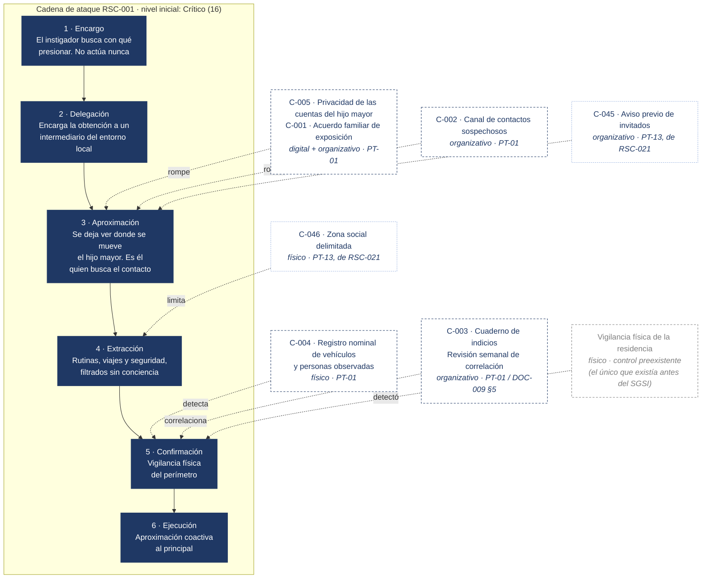

# RSC-001 — La cadena, eslabón a eslabón

**Revisión editorial v1.1 · 12/11/2026 · Borrador.** Corte operativo: 24/07/2026. Se distingue tratamiento diseñado, relato histórico y eficacia no acreditada. [Historial y deltas](revision_2026-11-12.md).

El riesgo que originó el SGSI, dibujado como lo trata la metodología (SGSI-DOC-004): una cadena de seis eslabones que cruza los dominios digital, organizativo y físico, con cada control del plan de tratamiento situado sobre el eslabón que rompe.

La regla de convergencia exige cobertura efectiva en los dominios cuya aplicabilidad está justificada para los escenarios Altos y Críticos. En RSC-001 están justificados ambos: mensajería y extracción de rutinas; encuentros, vigilancia del perímetro y aproximación coactiva. El tratamiento diseñado sitúa controles en los eslabones 3, 4 y 5. Ningún control del registro está implantado a fecha de corte: el diagrama representa funciones previstas, no cobertura efectiva acreditada.

**Nota sobre los controles prestados.** C-045 y C-046 pertenecen a RSC-021 y al plan PT-13, no a PT-01, que son C-001 a C-005. Aparecen aquí porque actúan también sobre esta cadena —el aviso previo de invitados y la zona social interrumpen la aproximación y limitan lo que se puede observar dentro— y porque RSC-021 es, literalmente, la vía por la que entró este escenario. Se dibujan con trazo distinto para que no se cuenten dos veces: la cobertura de RSC-001 a efectos de la regla de convergencia la dan C-004 (físico) y C-005 (digital).

## Lo que el diagrama cuenta

**Los dos primeros eslabones son inalcanzables, y eso es una conclusión, no una carencia.** El instigador no aparece nunca: no viaja, no llama, no escribe. Ningún control de Atalaya puede tocar el encargo ni la delegación. Un análisis honesto lo dice en vez de inventarse un control que "mitiga la motivación del actor". La cadena se ataca desde el eslabón 3.

**Antes del SGSI solo existía el control del eslabón 5.** La vigilancia física detectó, sí — pero detectar en el eslabón 5 significa detectar cuando el adversario ya tiene la información y está confirmándola sobre el terreno. Tarde y caro.

**Y detectó por azar.** Un miembro del servicio de seguridad reconoció un vehículo porque sabía de quién era y con quién andaba — no por la matrícula ni por ningún análisis. Esa capacidad no era repetible ni auditable: dependía de que esa persona estuviera de servicio, se acordara y atara los cabos. Si libra ese día, no se detecta nada. **El control funcionó una vez, y no por diseño.** Esa frase es el argumento fundacional de todo el sistema.

**El tratamiento empuja la detección hacia la izquierda.** La privacidad de las cuentas y el acuerdo de exposición encarecen la aproximación; el canal sin reproche y el aviso previo de invitados la interrumpen; la zona social limita lo que se puede observar dentro; y el cuaderno permite cruzar indicios si se registran con suficiente calidad y se revisan; la reconstrucción es condicional y no garantiza detectar el patrón en una semana concreta (reconstrucción documentada en SGSI-REG-004, hoja «Reconstrucción 2026»).

Las seis semanas de contacto pertenecen al relato del escenario; no representan una reducción de tiempo demostrada. El tratamiento pretende anticipar la detección, pero no se acredita una mejora temporal ni eficacia operativa.

**Riesgo residual previsto: Alto (8).** La aceptación por el jefe de seguridad y la ratificación por el Comité se conservan como decisiones narrativas históricas del caso, no como evidencia de reuniones celebradas, eficacia operativa o reducción alcanzada. Esta revisión editorial no revalora el residual ni altera el estado de aceptación de PT-01 en el registro. El tratamiento pretende dificultar la cadena y anticipar la detección; su resultado debe verificarse tras la implantación.

---

## El escenario que este diagrama no dibuja

RSC-001 es el riesgo estrella del caso, pero ya no está solo en lo más alto del registro. Tras la revisión de julio de 2026 empatan con él en el nivel máximo del registro, Crítico (16), otros dos escenarios: **RSC-018**, la inejecución sistemática de los controles físicos que ya existen, y **RSC-021**, la introducción de terceros no verificados en la residencia por los hijos.

Ninguno de los dos tiene un adversario en el origen. Y el segundo es, literalmente, la vía por la que entró este.
