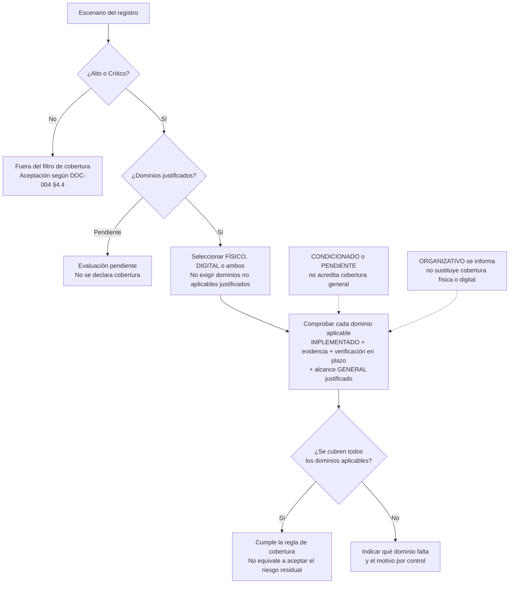

# Cobertura de los dominios aplicables

Revisión 2.0 · 27/09/2026 · DOC-004 §6 · Borrador pendiente de aprobación.

Se analizan siempre los dominios físico y digital. La cobertura se exige solo en los que intervengan en cada escenario Alto o Crítico. Los controles disponibles no determinan los dominios del escenario.

**Dos análisis distintos.** El dominio del escenario describe su cadena; el del control, cómo actúa la medida. Una copia digital o una comprobación presencial complementaria no convierten automáticamente el escenario en mixto. Los bloques del Anexo A tampoco deciden esas etiquetas.

**No aplicable y pendiente.** La no aplicabilidad necesita justificación. RSC-014 queda pendiente de precisar el medio de coacción: el programa no inventa ni descarta el dominio físico y no da un resultado favorable.

**Alcance condicionado.** C-059/C-065 solo actúan desde 50.000 euros; no se suman como cobertura física general. C-016/C-019 conservan pendiente justificar el mecanismo digital. C-062 es una instrucción organizativa al banco.

**Motivos.** RSC-016 tiene C-020 organizativo, pero ninguna medida digital computable. En RSC-018 hay medidas físicas y digitales simuladas, pero sus verificaciones han vencido. El modo `--detalle` distingue diseño, implantación, evidencia y vigencia.

**Resultados.** A fecha de corte (24/07/2026), ninguno de los 24 escenarios filtrados acredita cobertura; RSC-014 conserva la evaluación pendiente. En la demostración del 30/06/2027, 16 cumplen, 7 presentan carencias y 1 está pendiente. [Salida completa](../../tool/convergence-check/ejemplo_demo.txt).

El programa comprueba datos declarados, no abre las evidencias ni sustituye la aceptación del residual. [Justificaciones y deltas](revision_2026-09-27.md).
